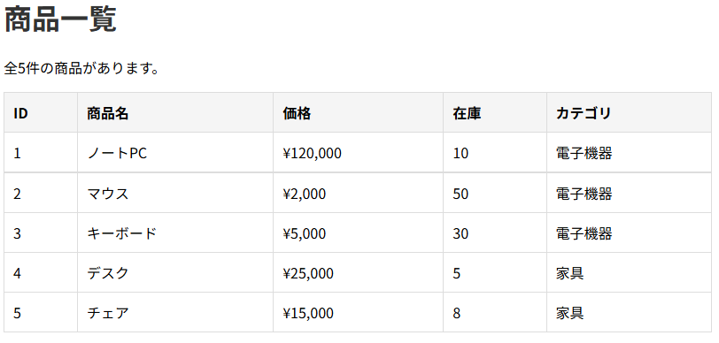

# database-app-practice

## 概要
COACHTECH 教材 Tutorial 9-3「データベース操作ハンズオン演習」で作成した成果物です。
マイグレーションファイルとシーダーファイルを作成し、テーブルに初期値を設定して画面に表示しました。

## 使用技術
- PHP 8.5.12
- Laravel 10.50.4
- MySQL
- マイグレーション、シーダー、クエリビルダ

## 学んだこと
- マイグレーションファイル内でテーブルのカラムや、各カラムの名前や制約などを設定する方法
- シーダーファイルに初期値を記述し、テーブルに初期値を挿入する方法
- クエリビルダーでテーブル内のデータを取得する方法

## 動作確認
1. database-app-practiceディレクトリ上でsail up -dコマンドによりyamlファイルに記述した構成通りのコンテナを起動させてネットワークで連携
2. sail artisan migrateコマンドによりテーブルを作成
3. sail artisan db:seed --class=ProductSeederコマンドによりテーブルに初期値を設定する
4. ブラウザで「`http://localhost/products`」のURLにアクセスして商品一覧ページが表示されることを確認

## 詰まったポイントと解決方法
- シーダーファイル内の一部情報を更新してテーブルに反映させる場合、単に再度sail artisan db:seed --class=ProductSeederコマンドを実行するだけでは、データが上書きされずinsertによってデータが追加される  
  ┗例えばコマンドライン上でsail artisan tinkerコマンドを実行し、その上でクエリビルダによりレコードを指定して特定のカラムの値を書き換えることができる

## 開発の工夫
- ルーティングの際にルート名を設定することで、他の箇所で該当のURLを使用する場合にルート名で管理できるようにした
- マイグレーションファイルを作成→コマンド実行→シードファイル作成→コマンド実行によってテーブルが作成され、そこにレコードを作成するという流れをイメージしながら開発した

## 動作確認のスクリーンショット
「`http://localhost/products`」にアクセスした時の商品一覧画面
